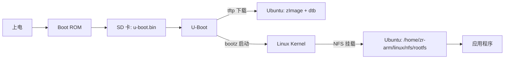

# I.MX6ULL 系统移植笔记（初始）

> 开发板：正点原子 I.MX6ULL（ALPHA/MINI，512MB DDR3）
> 方式：U-Boot 放 SD 卡，Kernel/DTB 走 TFTP，rootfs 走 NFS

## 一、Linux 基本理论

**系统移植**：把通用的 Linux 系统适配到具体的硬件平台（CPU、DDR、外设、存储），使其能正常启动并运行应用程序。移植主要是"配置 + 适配"，不是从零写代码。

一套可运行的嵌入式 Linux = **U-Boot + Kernel（含设备树）+ 根文件系统**，三者缺一不可。

| 组件 | 作用 | 移植要做的事 | 产物 |
|---|---|---|---|
| **U-Boot** | 第一级引导程序：初始化 DDR 等关键外设，从存储/网络加载内核并跳转执行，向内核传参（bootargs） | 适配板级文件、DDR 参数、串口/网卡驱动，编写编译脚本 | `u-boot.bin` / `u-boot.imx` |
| **Kernel** | 操作系统内核：管理内存/进程/中断，提供驱动与系统调用；靠**设备树**获知硬件信息 | 选择 defconfig 配置、编译设备树 `.dts`、使能所需驱动（网卡、MMC、串口） | `zImage` + `*.dtb` |
| **rootfs** | 根文件系统：提供 `/bin /sbin /lib /etc` 等命令、库、配置与启动脚本；内核最后的 `/sbin/init` 来自这里 | 用 BusyBox/Buildroot/Yocto 生成，补齐库与配置文件 | rootfs 目录树 / 镜像 |

三者的协作关系（启动链）：

```text
Boot ROM → U-Boot → Kernel(+设备树) → 挂载 rootfs → 执行 /sbin/init → 应用程序
```

- 没有 **U-Boot**：DDR 未初始化，内核根本无法被加载。
- 没有 **设备树**：内核不知道板上有哪些外设、地址是多少。
- 没有 **rootfs**：内核能启动，但找不到 `init`，最终 panic（`Unable to mount root fs`）。

---

## 二、整体架构

### 1. 启动链

```text
上电 → Boot ROM（芯片固化代码）→ U-Boot（引导程序）→ Linux Kernel → rootfs → 应用程序
```

- **Boot ROM**：从 SD/eMMC 读取 `u-boot.imx`，完成 DDR（DCD）初始化后跳转到 U-Boot。
- **U-Boot**：初始化 DDR、串口、MMC、网卡（FEC1），提供 `tftp`/`bootz` 命令，通过 `bootargs` 向内核传参。
- **Kernel**：读取设备树识别硬件，按 `root=` 挂载根文件系统，最后执行 `/sbin/init`。
- **rootfs**：提供 `/bin /sbin /lib /etc` 等，没有它内核跑起来也无法使用。

### 2. 开发阶段部署方式（与产品阶段对比）

| 阶段 | U-Boot | Kernel + DTB | rootfs |
|---|---|---|---|
| 产品阶段 | eMMC | eMMC | eMMC |
| **开发阶段（本笔记）** | **SD 卡** | **Ubuntu TFTP 服务器** | **Ubuntu NFS 服务器** |

开发阶段各组件分离，改内核只需重拷文件、改 rootfs 直接改 NFS 目录，无需反复烧写。



### 3. 网络与目录规划（

| 项目 | 值 |
|---|---|
| 开发板 IP | `192.168.5.101` |
| 服务器（Ubuntu）IP | `192.168.5.100` |
| 网关 | `192.168.5.1` |
| 子网掩码 | `255.255.255.0` |
| 开发板网卡 | `eth0`（FEC1） |
| TFTP 目录 | `~/linux/tftp/`（放 `zImage`、`imx6ull-alientek-emmc.dtb`） |
| NFS 根目录 | `/home/zr-arm/linux/nfs/rootfs` |

---

## 三、搭建步骤

### 步骤 0：环境准备

- Ubuntu 虚拟机（交叉编译 + TFTP/NFS 服务器）
- 交叉编译工具链（`mx6ull_alientek_emmc.sh` 中指定）
- MobaXterm（串口 115200）、FileZilla（文件传输）
- SD 卡 + 读卡器、开发板、USB 转串口线

### 步骤 1：编译并烧写 U-Boot

```bash
tar -xjf u-boot-imx-2016.03-2.1.0-g0ae7e33-v1.7.tar.bz2
cd u-boot-imx-2016.03-2.1.0-g0ae7e33-v1.7
gedit mx6ull_emmc_uboot.sh      # 确认交叉编译器前缀
chmod a+x mx6ull_emmc_uboot.sh
./mx6ull_emmc_uboot.sh
```

产物：`u-boot.bin`（烧写用）、`u-boot.imx`（含 DCD，Load 0x877ff420 / Entry 0x87800000）。

```bash
ls /dev/sd*                              # 插入 SD 卡后确认设备，如 /dev/sdb
./imxdownload u-boot.bin /dev/sdb        # 会生成 load.imx 并写入 SD 卡
```

启动板子：BOOT 拨码第 1、7 位拨到 ON 上方（SD 卡启动），串口打开后复位，出现 `Hit any key to stop autoboot` 时按回车进入 `=>` 命令行。

### 步骤 2：U-Boot 网络设置

```text
setenv ipaddr    192.168.5.101
setenv ethaddr   b8:ae:1d:01:00:00
setenv gatewayip 192.168.5.1
setenv netmask   255.255.255.0
setenv serverip  192.168.5.100
saveenv
```

验证：`ping 192.168.5.100` → `host 192.168.5.100 is alive`（说明 U-Boot 侧网络通）。

### 步骤 3：编译内核与设备树

```
这里的内核用整点原子教程源码编译出来的镜像，设备数用正点原子出厂的源码编译出来的。
````
```bash
sudo apt update && sudo apt install lzop      
tar -xjf linux-imx-rel_imx_4.1.15_2.1.1_ga_alientek_v2.2.tar.bz2
cd linux-imx-rel_imx_4.1.15_2.1.1_ga_alientek_v2.2
./mx6ull_alientek_emmc.sh                 

产物与拷贝：

```bash
arch/arm/boot/zImage                          # 内核镜像
arch/arm/boot/dts/imx6ull-alientek-emmc.dtb   # 设备树

cd arch/arm/boot/dts && cp imx6ull-alientek-emmc.dtb ~/linux/tftp/
cd ..                 && cp zImage ~/linux/tftp/
```

> 内核需包含 NFS 客户端、FEC 网卡、`ttymxc0` 串口驱动；正点原子默认配置已包含。

### 步骤 4：准备 rootfs（NFS 目录）

```bash
mkdir -p ~/linux/nfs/rootfs
sudo tar -xjf rootfs.tar.bz2 -C ~/linux/nfs/rootfs   # 用资料中的 rootfs，保持 root 权限
ls ~/linux/nfs/rootfs
# bin boot dev etc home lib media mnt opt proc run sbin sys tmp usr var
```

rootfs = 目录 + 命令 + 库 + 配置 + 启动脚本，可由 BusyBox（手工）/ Buildroot（自动）/ Yocto（工业级）生成。

Ubuntu 侧导出 NFS：

```bash
sudo gedit /etc/exports
# /home/zr-arm/linux/nfs/rootfs *(rw,sync,no_subtree_check,no_root_squash)
sudo exportfs -arv            # 或 sudo systemctl restart nfs-kernel-server
```

### 步骤 5：设置 bootcmd 与 bootargs

```text
setenv bootcmd 'tftp 80800000 zImage;tftp 83000000 imx6ull-alientek-emmc.dtb;bootz 80800000 - 83000000'

setenv bootargs 'console=ttymxc0,115200 root=/dev/nfs nfsroot=192.168.5.100:/home/zr-arm/linux/nfs/rootfs,v3,tcp rw ip=192.168.5.101:192.168.5.100:192.168.5.1:255.255.255.0::eth0:off'

saveenv
```

**bootargs 逐项解析**

| 参数 | 含义 |
|---|---|
| `console=ttymxc0,115200` | 串口 1（UART1）作控制台，波特率 115200 |
| `root=/dev/nfs` | 根文件系统由 NFS 提供 |
| `nfsroot=192.168.5.100:/home/zr-arm/linux/nfs/rootfs,v3,tcp` | NFS 服务器 IP : 导出目录，协议 NFSv3，传输 TCP |
| `rw` | 根文件系统以读写方式挂载 |
| `ip=...` | 静态 IP 配置，见下表 |

**ip= 字段次序**：`本机IP : 服务器IP : 网关 : 子网掩码 : DNS : 网卡 : 自动配置`

| 字段 | 值 | 说明 |
|---|---|---|
| 本机 IP | `192.168.5.101` | 开发板地址 |
| 服务器 IP | `192.168.5.100` | NFS/TFTP 服务器地址 |
| 网关 | `192.168.5.1` | 网关地址 |
| 掩码 | `255.255.255.0` | 子网掩码 |
| DNS | 空 | 不需要域名解析 |
| 网卡 | `eth0` | 使用 FEC1 网卡 |
| 自动配置 | `off` | 关闭 DHCP，纯静态配置 |

> 关键点：`ip=` 里的本机 IP、服务器 IP 必须与 U-Boot 中 `ipaddr`、`serverip` 完全一致，否则 TFTP 能下载但 NFS 挂载失败。

### 步骤 6：启动与验证

```text
tftp 80800000 zImage                       # 下载内核到 0x80800000
tftp 83000000 imx6ull-alientek-emmc.dtb    # 下载设备树到 0x83000000
bootz 80800000 - 83000000                  # 启动内核
```

- `bootz` 三个参数：zImage 地址 / `-`（不使用 initrd）/ DTB 地址。
- DDR 起始 `0x80000000`；`0x80800000`、`0x83000000` 是为避开 U-Boot 占用、互不覆盖而**人为选定**的加载地址。

成功标志：

```text
Kernel image @ 0x80800000 ...
## Flattened Device Tree blob at 83000000
Starting kernel ...
Booting Linux on physical CPU 0x0
Linux version 4.1.15 ...
```

最终进入 shell：`root@ATK-IMX6U:~#`

**验证 NFS 是否真的挂载成功**：在 Ubuntu 的 rootfs 目录执行 `sudo touch test.c`，开发板 `ls /` 能看到 `test.c`；在开发板创建文件，Ubuntu 侧也能看到 → 双向同步即 NFS 挂载正常。

---


## 四、全流程速查

```text
编译 U-Boot → imxdownload 烧到 SD 卡 → SD 卡启动进 U-Boot
→ 设置 ipaddr/serverip/saveenv → ping 通服务器
→ 装 lzop、编译内核 → zImage/dtb 拷到 ~/linux/tftp
→ rootfs 放到 ~/linux/nfs/rootfs 并导出 NFS
→ setenv bootcmd + bootargs（NFS 版）→ saveenv → 重启自动启动
```
