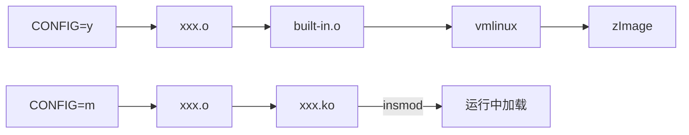
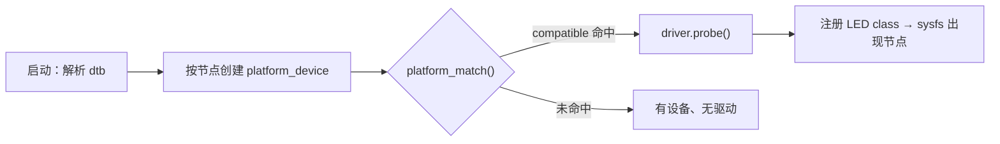

# 驱动的编译与匹配机制

> 平台：I.MX6ULL / Linux 4.1.15，示例为 `leds-gpio` 驱动 + 设备树 LED 节点

## 一、总览

| 环节 | 决定什么 | 阶段 |
|---|---|---|
| Kconfig / menuconfig / `.config` | 驱动**编不编**，`y` 还是 `m` | 编译 |
| Makefile | 哪个 `.c` 编成 `.o` / `.ko` | 编译 |
| 设备树 `compatible` | 驱动**用不用**（能否 `probe`） | 运行 |

> **menuconfig 决定"编不编"，设备树决定"用不用"。**
> 编译进内核 ≠ 驱动工作：没有 `compatible` 命中的节点，`probe()` 永不执行。
> 驱动代码写"怎么做"，设备树写"用在哪"——即内核的机制与策略分离。

---

## 二、理论①：Kconfig + Kbuild = 配置驱动编译

**Kconfig 定义"有哪些选项"，Kbuild 定义"怎么编译"，二者靠 `.config` 衔接。**

### 1. Kconfig：选项定义

```kconfig
# drivers/leds/Kconfig
config LEDS_GPIO
    tristate "LED Support for GPIO connected LEDs"
    depends on LEDS_CLASS
    depends on GPIOLIB
```

| 关键字 | 含义 |
|---|---|
| `bool` | 二态 `y/n` |
| `tristate` | 三态 `y/m/n` |
| `depends on` | 依赖不满足 → 选项**不可见、不可选** |
| `select` | 反向强制选中他项，易埋依赖坑，慎用 |
| `default` | 默认值 |

- `y` 内建、`m` 模块、`n` 不编译。
- 各目录 Kconfig 由上层 `source` 引入，构成树形菜单。不满足 `depends on` 的项**根本不显示**，所以必须先使能 `LEDS_CLASS`、`GPIOLIB`，`LEDS_GPIO` 才出现。

### 2. menuconfig → `.config`

```
make ARCH=arm menuconfig
  <*>  → CONFIG_LEDS_GPIO=y
  <M>  → CONFIG_LEDS_GPIO=m
  < >  → # CONFIG_LEDS_GPIO is not set
```

- `.config` 是编译的**唯一事实来源**；`defconfig` 只是预设模板，menuconfig 在其基础上改并写回。
- Kconfig 只影响"能不能选"，真正决定编译动作的是 Makefile。

### 3. Kbuild：把配置变成编译动作

```make
# drivers/leds/Makefile
obj-$(CONFIG_LEDS_GPIO) += leds-gpio.o
```

展开为 `obj-y`（进内核）或 `obj-m`（生成 `.ko`）。Kbuild 自顶向下递归各子目录：

```text
各层 .o → built-in.o → vmlinux → （arch/arm/boot 压缩封装）→ zImage
```

> 改 Kconfig/Makefile 只影响编译产物，与运行时匹配无关。

---

## 三、理论②：内建（`y`）与模块（`m`）



| | 内建 `=y` | 模块 `=m` |
|---|---|---|
| 产物 | `vmlinux` → `zImage` | `xxx.ko` |
| 位置 | 内核镜像内 | rootfs：`/lib/modules/$(uname -r)/` |
| 入口 | `module_init` 链接为 `__initcall`，启动时统一执行 | `insmod` 时由加载器调用 |
| 卸载 | 不支持 | `rmmod` → `module_exit` |
| 可用符号 | 直接链接 | 仅 `EXPORT_SYMBOL` 导出者 |

理论要点：

- **`.ko` 不是普通可执行文件**：它是可重定位 ELF，不链接 libc，未解析符号在加载时由内核重定位。
- `vermagic`（内核版本 + 配置 + 架构）写入模块，与运行内核不符即拒绝加载 → 所以模块必须针对目标内核编译。
- 加载链：`insmod` → `init_module` 系统调用 → `load_module()` 解析 ELF/依赖、重定位、校验 `vermagic` → 调 `module_init` 指定的入口。
- `depmod` 生成 `modules.dep`；`modprobe` 据此自动加载依赖；`mdev/udev` 负责设备节点与开机自动加载。
- 缺少 `MODULE_LICENSE` 会使内核 `tainted`（受污染）。
- 模块化意义：裁剪镜像体积、按需加载、改驱动不必重刷内核。

---

## 四、理论③：设备—总线—驱动模型

驱动生效的本质是内核驱动模型完成了 **device ↔ driver 绑定**。

### 1. 三个核心对象

| 对象 | 结构体 | 作用 |
|---|---|---|
| 总线 | `bus_type` | 提供 `match()`，负责配对 |
| 设备 | `platform_device` | 描述"有什么硬件"（来自设备树） |
| 驱动 | `platform_driver` | 描述"怎么操作这类硬件" |

- 三者均基于 `kobject`，在 sysfs 有目录：`/sys/bus`、`/sys/devices`、`/sys/class`。
- **platform 总线**专用于 SoC 片内外设（GPIO、I2C、LED 等）：它们不像 PCI/USB 能自描述，硬件信息只能由设备树提供。

### 2. 匹配过程



`platform_match()` 依次尝试：`driver_override` → **`of_match_table` 比对 `compatible`** → ACPI → `id_table` → 设备名。

```c
static const struct of_device_id of_gpio_leds_match[] = {
    { .compatible = "gpio-leds" },   // 与 dts 字符串完全一致
    {},
};
```

- 命中 → `really_probe()` → 驱动 `probe()`：解析属性、申请资源（GPIO/中断）、注册子系统设备。
- 返回 `-EPROBE_DEFER` 表示依赖（时钟、GPIO 控制器）未就绪，总线会延后重试。
- 同一 `compatible` 的**每个节点各 `probe` 一次**。

### 3. 内建与模块的匹配时机差异

| 形式 | 启动时 | 绑定时机 |
|---|---|---|
| `=y` | 设备与驱动都在 | 启动过程中立即匹配 |
| `=m` | 只有 `platform_device` | `insmod` 注册驱动后，总线回头匹配已有设备 |

> 对应课件现象：`insmod` 前 `/sys/class/leds` 只有 `mmc0/mmc1`；加载 `leds-gpio.ko` 后才出现 `sys-led_dr_wei`、`beep`。
> 原因：设备早已由 dtb 创建，缺的是驱动；驱动一注册，总线即重新匹配。

---

## 五、实操：配置与编译

### 5.1 设置交叉编译环境

```sh
# 每开新终端都要 source 一次，它导出 ARCH / CROSS_COMPILE / PATH 等变量
source /opt/fsl-imx-x11/4.1.15-2.1.0/environment-setup-cortexa7hf-neon-poky-linux-gnueabi

echo $CROSS_COMPILE        # 应输出 arm-poky-linux-gnueabi-
echo $ARCH                 # 应输出 arm
```

### 5.2 选配置（决定驱动编不编）

```sh
cd ~/linux/linux-imx6ull
make ARCH=arm menuconfig
```

- 内核镜像要含 LED 驱动：`Device Drivers → LED Support → <*> LED Support for GPIO connected LEDs`
- 驱动要以模块形式验证：同一项选 `<M>`
- 前置依赖 `LEDS_CLASS`、`GPIOLIB` 不满足时，该项根本不显示

配置完成后确认：

```sh
grep LEDS_GPIO .config          # CONFIG_LEDS_GPIO=m  或  =y
```

### 5.3 编译（按需选命令）

| 目的 | 命令 | 产物 |
|---|---|---|
| 编内核 | `make zImage -j4` | `arch/arm/boot/zImage` |
| 编模块 | `make modules -j4` | `drivers/leds/leds-gpio.ko` |
| 编设备树 | `make dtbs`<br/>或 `make ARCH=arm CROSS_COMPILE=arm-linux-gnueabihf- dtbs` | `arch/arm/boot/dts/imx6ull-14x14-emmc-7-1024x600-c.dtb` |

```sh
ls -l arch/arm/boot/zImage
ls -l drivers/leds/leds-gpio.ko
ls -l arch/arm/boot/dts/imx6ull-14x14-emmc-7-1024x600-c.dtb
```

**驱动改成 `M` 要跑几条命令？**
只要 `.ko`：`source` + `make modules`（2 步）；需同时刷新内核镜像才加 `make zImage`（3 步）。

> 提速小技巧：`.config` 已正确时，只编 LED 目录可用 `make ARCH=arm M=drivers/leds modules`。

### 5.4 为什么编内核和编设备树可以用不同的交叉编译器？

**一句话**：编内核要产出 ARM **机器码**，编 dtb 只是把文本"展开 + 打包"，跟 ARM 指令毫无关系。

#### 先看两者的产物差在哪

| | `zImage` | `dtb` |
|---|---|---|
| 本质 | ARM 能执行的**指令** | 一份**数据清单**（描述"板子上有什么硬件"） |
| 谁来生成 | 交叉 gcc → as → ld（必须懂 ARM） | 内核自带的 `dtc`（跑在 x86 上的普通程序） |
| gcc 的角色 | 真正编译 | 只当"文本展开器"用 |

所以：编 zImage 时 gcc 必须"会说 ARM 语"，编 dtb 时 gcc 只被叫去"把 include 和宏展开一下"。

#### dtb 是怎么生成的

```make
# scripts/Makefile.lib（简化）
# 第 1 步：预处理，把 #include / #define 展开，输出还是纯文本
cmd_dtc = $(CPP) $(dtc_cpp_flags) -o $(dtc-tmp) $<
# 第 2 步：dtc 把纯文本 dts 打包成二进制 dtb
          ; $(obj)/dtc -I dts -O dtb -o $@ $(dtc-tmp)
```


**关键**：整条链路里没有任何一步需要"生成 ARM 指令"。gcc 在这里被降级成一个文本替换工具——用 x86 的 gcc 干这活也一样。

#### 为什么换个 gcc 展开结果也完全一样

内核给预处理加了 3 个约束，把"工具链差异"排除掉了：

| 参数 | 作用 | 不这么做会怎样 |
|---|---|---|
| `-E` | 只预处理，不做编译 | —— |
| `-undef` | **禁用**编译器自带的内置宏（`__arm__`、`__GNUC__` 之类） | 不同版本 gcc 展开出的文本不同，dtb 可能不一致 |
| `-nostdinc` | 不搜索工具链的 C 头文件，只在**内核源码**里找 dts / `dt-bindings`（也是纯文本） | 结果受工具链版本影响 |

唯一的"输入"来自内核源码自己的 dts/dtsi/`dt-bindings`，`dtc` 又是由**宿主机 gcc** 编出来的，所以 `CROSS_COMPILE` 填谁都一样。

#### 反过来，编内核为什么不能随便换

`make zImage` 要真的生成 ARMv7 指令、浮点 ABI 要和内核配置一致、`ld` 要能链接 ARM 目标文件。工具链不匹配的后果是链接失败或镜像启动不了，而不是"结果略有不同"。


---

## 六、实操：改设备树 → 编译 → 验证

### 6.1 修改 dts

```sh
cd ~/linux/kernel_complete
ls arch/arm/boot/dts/imx6ull-14x14-emmc-7-1024x600-c.dts   # 板级入口
```

**① 引脚复用（pinctrl）**：保证引脚被复用成 GPIO。

```dts
&iomuxc {
    pinctrl_gpio_leds: gpio-leds {
        fsl,pins = <
            MX6UL_PAD_GPIO1_IO03__GPIO1_IO03  0x10B0   // 引脚宏 / 电气属性
        >;
    };
};
```

> 宏名与电气属性值随板卡而异，以实际 dts 中已有写法为准，不要照抄。

**② 设备节点**

```dts
leds {
    compatible = "gpio-leds";                          // 匹配关键字，须与 of_match_table 一致
    pinctrl-names = "default";
    pinctrl-0 = <&pinctrl_gpio_leds &pinctrl_beep>;    // 引脚复用配置

    led1_dr_wei {
        label = "sys-led_dr_wei";                      // 决定 /sys/class/leds/ 下的目录名
        gpios = <&gpio1 3 GPIO_ACTIVE_LOW>;            // 控制器 / 引脚号 / 有效电平
        linux,default-trigger = "none";                // 不用内核触发器，交用户空间
        default-state = "on";
    };

    beep {
        label = "beep";
        gpios = <&gpio5 1 GPIO_ACTIVE_LOW>;
        default-state = "off";
    };
};
```

| 属性 | 作用 |
|---|---|
| `compatible` | 匹配关键字，须与 `of_match_table` 完全一致 |
| `pinctrl-0` | 引脚复用配置 |
| `label` | 决定 `/sys/class/leds/<label>/` 路径名，改了要同步改应用 |
| `gpios` | 控制器 / 引脚号 / 有效电平 |
| `linux,default-trigger` | `none` 表示不由内核自动控制，交用户空间 |

### 6.2 编译

```sh
source /opt/fsl-imx-x11/4.1.15-2.1.0/environment-setup-cortexa7hf-neon-poky-linux-gnueabi

make ARCH=arm menuconfig     # Device Drivers → LED Support → <M> LEDS_GPIO
make modules -j16            # 得到 drivers/leds/leds-gpio.ko
make  dtbs                   # 改了 dts 才需要
```

确认产物：`grep LEDS_GPIO .config`、`ls -l drivers/leds/leds-gpio.ko arch/arm/boot/dts/*.dtb`。

### 6.3 部署

```sh
# dtb 放 TFTP，供 u-boot 下载
cp arch/arm/boot/dts/imx6ull-14x14-emmc-7-1024x600-c.dtb ~/linux/tftp/

# .ko 与测试程序放 NFS rootfs
cp drivers/leds/leds-gpio.ko /home/zr-arm/linux/nfs/rootfs/
cd ~/iM6ULL_DriverLearning/device-tree
arm-linux-gnueabihf-gcc led_app_test.c -o led_app_test
cp led_app_test /home/zr-arm/linux/nfs/rootfs/home/root/
```

### 6.4 板端验证

```sh
insmod leds-gpio.ko
ls /sys/class/leds/                        # 期望出现 sys-led_dr_wei / beep
cd /home/root && chmod +x led_app_test && ./led_app_test
```

| 观察点 | 结论 |
|---|---|
| 出现 `sys-led_dr_wei` / `beep` | dtb 生效 + 驱动匹配成功（device→driver 绑定完成） |
| 只有 `mmc0/mmc1` | dtb 未更新，或 `compatible` 与 `of_match_table` 不符 |
| LED 亮 1 秒、灭 2 秒循环 | 全链路打通 |
| `insmod` 报 `invalid module format` | `vermagic` / 架构 / 内核版本不一致 |

