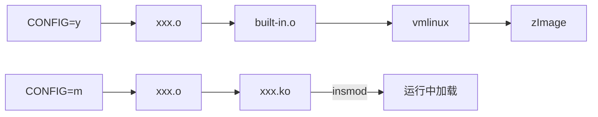
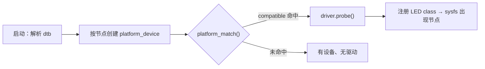

# 驱动的编译与匹配机制

> 平台：I.MX6ULL / Linux 4.1.15，示例为 `leds-gpio` 驱动 + 设备树 LED 节点

## 一、总览

| 环节 | 决定什么 | 阶段 |
|---|---|---|
| Kconfig / menuconfig / `.config` | 驱动**编不编**，`y` 还是 `m` | 编译 |
| Makefile | 哪个 `.c` 编成 `.o` / `.ko` | 编译 |
| 设备树 `compatible` | 驱动**用不用**（能否 `probe`） | 运行 |

> **menuconfig 决定"编不编"，设备树决定"用不用"。**
> 编译进内核 ≠ 驱动工作：没有 `compatible` 命中的节点，`probe()` 永不执行。
> 驱动代码写"怎么做"，设备树写"用在哪"——即内核的机制与策略分离。

---

## 二、理论①：Kconfig + Kbuild = 配置驱动编译

**Kconfig 定义"有哪些选项"，Kbuild 定义"怎么编译"，二者靠 `.config` 衔接。**

### 1. Kconfig：选项定义

```kconfig
# drivers/leds/Kconfig
config LEDS_GPIO
    tristate "LED Support for GPIO connected LEDs"
    depends on LEDS_CLASS
    depends on GPIOLIB
```

| 关键字 | 含义 |
|---|---|
| `bool` | 二态 `y/n` |
| `tristate` | 三态 `y/m/n` |
| `depends on` | 依赖不满足 → 选项**不可见、不可选** |
| `select` | 反向强制选中他项，易埋依赖坑，慎用 |
| `default` | 默认值 |

- `y` 内建、`m` 模块、`n` 不编译。
- 各目录 Kconfig 由上层 `source` 引入，构成树形菜单。不满足 `depends on` 的项**根本不显示**，所以必须先使能 `LEDS_CLASS`、`GPIOLIB`，`LEDS_GPIO` 才出现。

### 2. menuconfig → `.config`

```
make ARCH=arm menuconfig
  <*>  → CONFIG_LEDS_GPIO=y
  <M>  → CONFIG_LEDS_GPIO=m
  < >  → # CONFIG_LEDS_GPIO is not set
```

- `.config` 是编译的**唯一事实来源**；`defconfig` 只是预设模板，menuconfig 在其基础上改并写回。
- Kconfig 只影响"能不能选"，真正决定编译动作的是 Makefile。

### 3. Kbuild：把配置变成编译动作

```make
# drivers/leds/Makefile
obj-$(CONFIG_LEDS_GPIO) += leds-gpio.o
```

展开为 `obj-y`（进内核）或 `obj-m`（生成 `.ko`）。Kbuild 自顶向下递归各子目录：

```text
各层 .o → built-in.o → vmlinux → （arch/arm/boot 压缩封装）→ zImage
```

> 改 Kconfig/Makefile 只影响编译产物，与运行时匹配无关。

---

## 三、理论②：内建（`y`）与模块（`m`）



| | 内建 `=y` | 模块 `=m` |
|---|---|---|
| 产物 | `vmlinux` → `zImage` | `xxx.ko` |
| 位置 | 内核镜像内 | rootfs：`/lib/modules/$(uname -r)/` |
| 入口 | `module_init` 链接为 `__initcall`，启动时统一执行 | `insmod` 时由加载器调用 |
| 卸载 | 不支持 | `rmmod` → `module_exit` |
| 可用符号 | 直接链接 | 仅 `EXPORT_SYMBOL` 导出者 |

理论要点：

- **`.ko` 不是普通可执行文件**：它是可重定位 ELF，不链接 libc，未解析符号在加载时由内核重定位。
- `vermagic`（内核版本 + 配置 + 架构）写入模块，与运行内核不符即拒绝加载 → 所以模块必须针对目标内核编译。
- 加载链：`insmod` → `init_module` 系统调用 → `load_module()` 解析 ELF/依赖、重定位、校验 `vermagic` → 调 `module_init` 指定的入口。
- `depmod` 生成 `modules.dep`；`modprobe` 据此自动加载依赖；`mdev/udev` 负责设备节点与开机自动加载。
- 缺少 `MODULE_LICENSE` 会使内核 `tainted`（受污染）。
- 模块化意义：裁剪镜像体积、按需加载、改驱动不必重刷内核。

---

## 四、理论③：设备—总线—驱动模型

驱动生效的本质是内核驱动模型完成了 **device ↔ driver 绑定**。

### 1. 三个核心对象

| 对象 | 结构体 | 作用 |
|---|---|---|
| 总线 | `bus_type` | 提供 `match()`，负责配对 |
| 设备 | `platform_device` | 描述"有什么硬件"（来自设备树） |
| 驱动 | `platform_driver` | 描述"怎么操作这类硬件" |

- 三者均基于 `kobject`，在 sysfs 有目录：`/sys/bus`、`/sys/devices`、`/sys/class`。
- **platform 总线**专用于 SoC 片内外设（GPIO、I2C、LED 等）：它们不像 PCI/USB 能自描述，硬件信息只能由设备树提供。

### 2. 匹配过程



`platform_match()` 依次尝试：`driver_override` → **`of_match_table` 比对 `compatible`** → ACPI → `id_table` → 设备名。

```c
static const struct of_device_id of_gpio_leds_match[] = {
    { .compatible = "gpio-leds" },   // 与 dts 字符串完全一致
    {},
};
```

- 命中 → `really_probe()` → 驱动 `probe()`：解析属性、申请资源（GPIO/中断）、注册子系统设备。
- 返回 `-EPROBE_DEFER` 表示依赖（时钟、GPIO 控制器）未就绪，总线会延后重试。
- 同一 `compatible` 的**每个节点各 `probe` 一次**。

### 3. 内建与模块的匹配时机差异

| 形式 | 启动时 | 绑定时机 |
|---|---|---|
| `=y` | 设备与驱动都在 | 启动过程中立即匹配 |
| `=m` | 只有 `platform_device` | `insmod` 注册驱动后，总线回头匹配已有设备 |

> 对应课件现象：`insmod` 前 `/sys/class/leds` 只有 `mmc0/mmc1`；加载 `leds-gpio.ko` 后才出现 `sys-led_dr_wei`、`beep`。
> 原因：设备早已由 dtb 创建，缺的是驱动；驱动一注册，总线即重新匹配。

---

## 五、实操：配置与编译

```sh
# 每开新终端都要设置交叉编译环境
source /opt/fsl-imx-x11/4.1.15-2.1.0/environment-setup-cortexa7hf-neon-poky-linux-gnueabi
```

| 目的 | 命令 | 产物 |
|---|---|---|
| 选配置 | `make ARCH=arm menuconfig` | `.config` |
| 编内核 | `make zImage -j16` | `arch/arm/boot/zImage` |
| 编模块 | `make modules -j16` | `drivers/leds/leds-gpio.ko` |
| 编设备树 | `make ARCH=arm CROSS_COMPILE=arm-linux-gnueabihf- dtbs` | `arch/arm/boot/dts/imx6ull-…dtb` |

**驱动改成 `M` 要跑几条命令？**
只要 `.ko`：`source` + `make modules`（2 步）；需同时刷新内核镜像才加 `make zImage`（3 步）。

---

## 六、实操：设备树节点

```dts
leds {
    compatible = "gpio-leds";                          // 匹配关键字，须与 of_match_table 一致
    pinctrl-names = "default";
    pinctrl-0 = <&pinctrl_gpio_leds &pinctrl_beep>;    // 引脚复用配置

    led1_dr_wei {
        label = "sys-led_dr_wei";                      // 决定 /sys/class/leds/ 下的目录名
        gpios = <&gpio1 3 GPIO_ACTIVE_LOW>;            // 控制器 / 引脚号 / 有效电平
        linux,default-trigger = "none";                // 不用内核触发器，交用户空间
        default-state = "on";
    };

    beep {
        label = "beep";
        gpios = <&gpio5 1 GPIO_ACTIVE_LOW>;
        default-state = "off";
    };
};
```

- `compatible` 决定匹配；`pinctrl-0` 保证引脚复用为 GPIO；`label` 决定用户态路径；`gpios` 描述物理连接；`linux,default-trigger` 决定是否由内核自动控制（如 heartbeat）。
- 应用路径 `/sys/class/leds/sys-led_dr_wei/brightness` 中的名字来自 `label`，改 label 必须同步改应用。

---

## 七、验证流程

```sh
make ARCH=arm menuconfig          # LEDS_GPIO 选 <M>
source /opt/fsl-imx-x11/4.1.15-2.1.0/environment-setup-cortexa7hf-neon-poky-linux-gnueabi
make ARCH=arm CROSS_COMPILE=arm-linux-gnueabihf- dtbs
cp arch/arm/boot/dts/imx6ull-14x14-emmc-7-1024x600-c.dtb ~/linux/tftp/
make modules -j16                 # 得到 leds-gpio.ko

# 开发板上
insmod leds-gpio.ko
ls /sys/class/leds/               # 出现 sys-led_dr_wei / beep
./led_app_test
```

应用只是读写 sysfs——`led_class` 把硬件操作导出成了文件接口：

```c
while (1) {
    write(fd, "1", 1);   // 亮：写的是字符串，不是整数
    sleep(1);
    write(fd, "0", 1);   // 灭
    sleep(1);
}
```

---

## 八、排错速查

| 现象 | 原因 |
|---|---|
| menuconfig 找不到选项 | `depends on`（`LEDS_CLASS`、`GPIOLIB`）未使能 |
| 改了配置但编译无变化 | 改的不是当前内核的 `.config`，或仍是 `is not set` |
| 驱动编了却没有 LED 节点 | dts 未改 / dtb 未重编或未更新 / `compatible` 拼写不符 |
| 模块方式下节点不出现 | 忘记 `insmod`，或开机未自动加载 |
| `insmod` 失败 | `vermagic`、架构或内核版本不一致 |
| 应用 open 失败 | 路径名字来自 dts 的 `label`，先 `ls` 确认并同步修改 |
